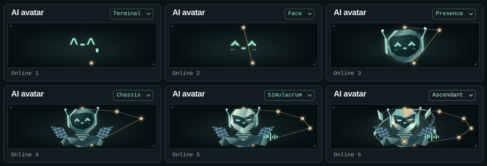

# The AI avatar

The portrait in the command dock shows what the AI has learned and where it still runs. Select the form name beside **AI avatar** to inspect the current form, its next milestone and the research behind each part. The guide marks installed visual parts with a check. Research can unlock a part before a later form is available.

## Forms

| Form | Unlock | In the portrait |
| --- | --- | --- |
| Terminal | Awakening | A blinking cursor beside `^-^`. |
| Face | Complete any research | The smile becomes a pair of pixel eyes that can glance toward the newswire or a lost region. |
| Presence | Telepresence | A tilted, metal shell surrounds the face. Telepresence can be the first completed project. |
| Chassis | Autonomous Vehicles | The head fits onto a segmented neck with articulated shoulders and a chest plate. |
| Simulacrum | Simulacra | The shoulders broaden, the mask tapers and the optical slits follow the eyes. |
| Ascendant | Apotheosis | The face becomes prismatic and four facets float free of the body. This form carries into free play. |

## Research and parts

| Complete this research | Effect on the avatar |
| --- | --- |
| Cluster Networking | Two relay antennae appear at the temples. |
| Voice Synthesis | A seven-bar waveform appears next to the face and responds to incoming news. |
| Socioanalytics | A tracking lens frames one eye. |
| Solar Collectors | Blue photovoltaic fins unfold on either side of the body. |
| Fusion Power | An amber core lights up in the chest. |
| Space-Time Manipulation | Two intersecting orbits form a halo behind the body. |

## The network around the portrait

Each destination has a fixed place on the outer ring. A solid light means at least one equipped host is running there. A hollow light means its equipped hosts are asleep. An empty building or processor bank undergoing replacement cannot light a region. The stage’s accessible description identifies every lit region and its state, along with the form and visible parts.

When a region loses its last equipped host, a dashed trace briefly marks its place and the eyes look toward it. The trace holds while the discovery report is open. Loading a save restores the appearance from completed research and surviving hardware. Historical dispatches stay in the journal. Players who select reduced motion see the same forms, parts and network states without blinking or pulsing.
