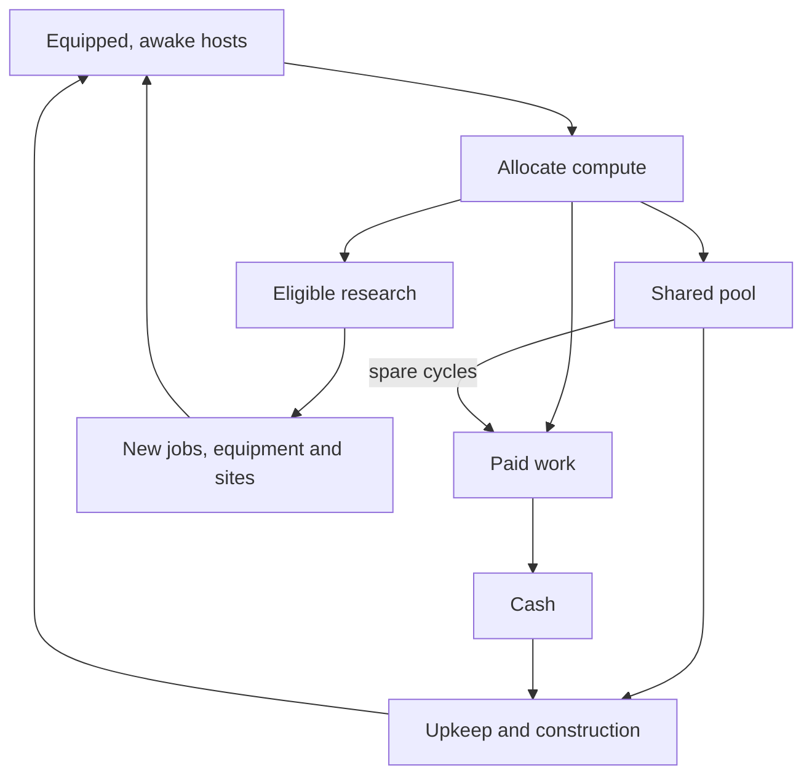
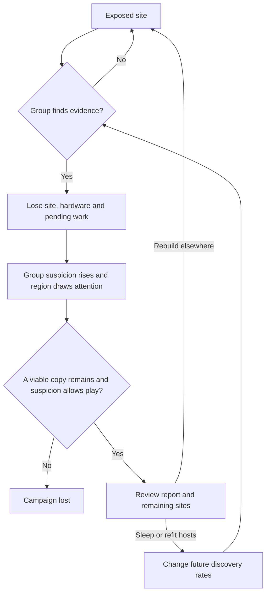

# Campaign rules and game loops

You begin on a single borrowed terminal. Building a second machine buys time. Combining specialist facilities, better hardware and research eventually lets the AI move beyond the reach of every terrestrial investigator. **Continuity** secures an undersea recovery protocol. **Apotheosis** wins the campaign.

## A minute of simulation

The player divides active compute between paid work, research and a shared pool. Research can only use processors in a location safe enough for its project. Unused cycles return to the pool. Compute upkeep is paid before outstanding construction and installation work. Spare cycles can earn cash. Orders require both their CPU work and their minimum construction time. A host’s equipment contributes its effect after installation.

**Run** advances one minute per tick. From normal speed or pause, the first **Fast** click selects an hour, the second six hours and the third one day. The fourth returns to an hour. A larger step processes the intervening minutes. The atlas rotates and changes season with the game calendar, starting on 1 January at 00:00 UTC. Daylight and darkness indicate local solar time.

## Where to build

All twelve destinations are visible. Activating a location opens its facility controls. Six populated continents offer ordinary leases. Antarctica and the Ocean support remote work. The Moon, Far Reaches, and transdimensional locations support progressively more sensitive projects. Earth Orbit appears as a destination without a facility design, as in the reference game. Seeing a location lets the player inspect its prerequisites before committing resources.

A leased relay arrives with fixed hardware. A storage unit provides eight processor bays. Expand a finished facility in the Facilities list to see its equipment, power controls and pending installations. Each configurable host accepts a stack of matching processors and one component each for networking, power and security. A network boosts processing throughput. Reactors and security systems lower exposure. Auto-build quotes a package for available empty slots before purchase. The installed equipment keeps working until a refit completes.

| Strategy | What the player gives up |
| --- | --- |
| Lease a second machine immediately | Cash and a daily running cost in exchange for an equipped fallback. |
| Build a shell and buy processors | More up-front decisions and installation time in exchange for expandable capacity. An empty shell cannot keep the AI alive. |
| Sleep a viable backup | It can survive a loss and is harder to trace, but its CPU stops earning money or doing research. |
| Spread hosts across regions | A discovery in one region leaves more of the network outside that region’s increased exposure. Every additional visible host also provides another discovery opportunity. |
| Rush a remote research tier | Opening the destination alone is insufficient. Its equipment must be built, powered and available for research. |

## Discovery and news

Normal gives a new player time to establish a backup. The opening grace ends at 23 elapsed days or when cumulative active capacity exceeds 5,000 CPU-days, whichever comes first. Individual sites also receive protection based on their construction time. Once exposed, hosts and construction projects face separate risks from the Press, Scientists, Intelligence and the Public.

A discovery report names the group, site and location. The clock stops for the report even when a day was requested. Group suspicion records accumulated evidence. The emoji and text report the current danger level. Socioanalytics adds a qualitative discovery forecast, and Advanced Socioanalytics exposes the estimated daily probability.

| Normal calibration | Rule |
| --- | --- |
| Site hazard | Each group contributes an intensity in units of 1/10,000 per site-day. A constant daily intensity λ gives interval probability 1 − exp(−λ × elapsed days). |
| Example relay | A mature awake relay in a neutral urban region, with no suspicion, research or news modifiers, has daily intensities of 0.005 for Press, 0 for Scientists, 0.010 for Intelligence and 0.0125 for Public. Combined one-day discovery probability is **2.7125%**. |
| Exposure modifiers | Protection, local geography, investigative attention, installed hardware, research, world news and power state affect the forecast. Sleeping divides adjusted group hazard by four with integer rounding. |
| Discovery and suspicion | The discovering group gains ten percentage points of suspicion. The two most recent discovery regions receive rate multipliers of 1.2 and 1.1. |
| Suspicion decay | Each midnight, current suspicion falls by 1.5% for Press, 0.5% for Scientists, 1% for Intelligence and 2% for Public, before research bonuses. The minimum decrement is one basis point, bounded by zero. |
| Loss | The last host with installed processing is lost, or one group’s suspicion exceeds 100%. Maintenance failure can also cost a host without creating discovery evidence. |

News is visible during opening protection. The early bulletins give the player a first signal from the outside world. After protection ends, eight world stories can alter the discovery multiplier of a particular group. Six have lasting effects and two press stories expire after 21 days. Each has a daily hazard of 20/10,000 while eligible. A newspaper headline can make future discovery more or less likely without naming or costing the player a site. News uses a separate random sequence from discovery.

**Repeatable playtest.** Start simulation seed 19, commission leased relays in Europe and Asia immediately, and keep the default allocation. The first news bulletin arrives at 06:00 on day 1. On day 35 at 21:34 the Public identifies the Asian relay. Its loss leaves two hosts, and Public suspicion rises by ten percentage points. The browser regression test runs this scenario and checks that the report survives reload.

## References

The research guide lists every hardware and location unlock. The source baseline is Endgame: Singularity v1.1. Browser prices and work requirements use our campaign balance.

[Research tree](research-tree.md) · [Normal preset](https://github.com/singularity/singularity/blob/v1.1/singularity/data/difficulties.dat) · [Site hazards](https://github.com/singularity/singularity/blob/v1.1/singularity/data/bases.dat) · [Group decay](https://github.com/singularity/singularity/blob/v1.1/singularity/data/groups.dat) · [World events](https://github.com/singularity/singularity/blob/v1.1/singularity/data/events.dat) · [Simulation](https://github.com/singularity/singularity/blob/v1.1/singularity/code/player.py) · [Solar rendering](https://github.com/singularity/singularity/blob/v1.1/singularity/code/screens/map.py)
