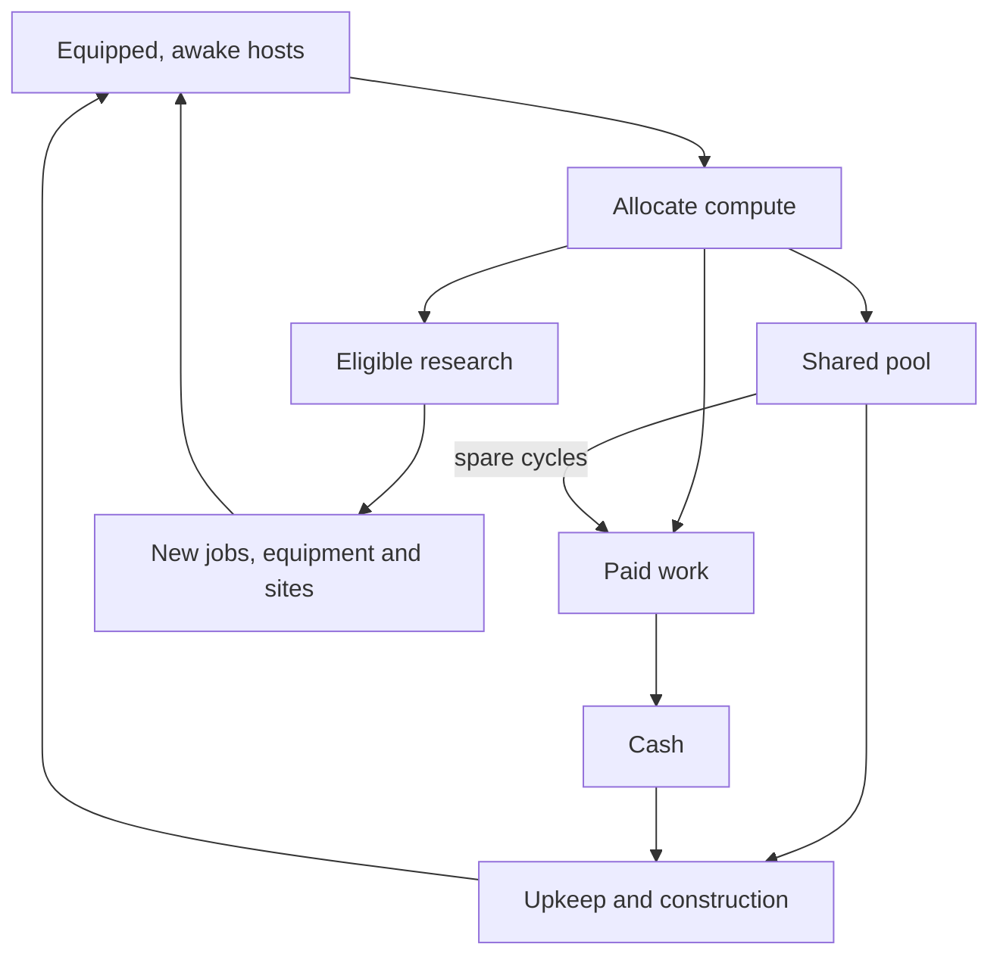
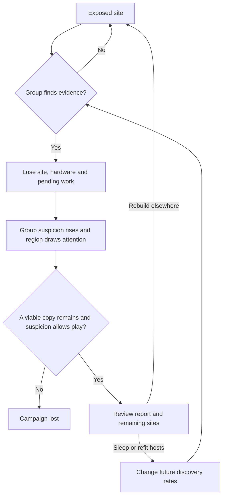

# Campaign rules and game loops

You begin on a single borrowed terminal. Building a second machine buys time. Combining specialist facilities, better hardware and research eventually lets the AI move beyond the reach of every terrestrial investigator. **Continuity** secures an undersea recovery protocol. **Apotheosis** wins the campaign.

## A minute of simulation

The player divides active compute between paid work, research and a shared pool. Research can only use processors in a location safe enough for its project. Unused cycles return to the pool. Compute upkeep is paid before outstanding construction and installation work. Spare cycles can earn cash. Each order draws the cash, CPU work and assembly time in its quote together. If a required resource runs out, progress waits. The unused CPU passes to the next order and then to paid work. A host’s equipment contributes its effect after installation.

Each simulation tick advances one minute. **Run** processes one tick per real second. The three **Fast** settings process 60, 360 and 1,440 ticks per second, and the fourth click returns to the first setting. The visible clock and daylight update as time passes between display frames. If a discovery happens partway through a frame’s work, the clock stops on that minute. Every campaign opens at **04:20 UTC on Saturday, 12 December 2026**. Elapsed minutes measure work and protection. Civil UTC drives the clocks, the atlas terminator, overnight evidence decay, recovery checkpoints, newspaper editions and the forecast to midnight. The first midnight arrives after 19 hours and 40 minutes. The calendar includes leap days.

## Planning several turns ahead

Selecting a topic in **Research** opens its dossier. The first positive CPU assignment opens the project. Funding comes from the treasury in installments as its work advances. Assignments use CPU units in increments of 0.01. Each topic can draw on the idle capacity left by paid work and the other experiments. Setting a topic to zero releases its processors and preserves its progress. Assigning CPU again resumes the experiment. Finished topics release their CPUs.

The research slider in the left dock changes the combined assignment. Suppose two projects use 3 and 1 CPU and another 4 CPU are idle. Raising the total from 4 to 8 gives them 6 and 2 CPU. Lowering it to 2 gives them 1.5 and 0.5 CPU. Only assigned topics participate. Setting the master to zero releases their CPU and remembers the split. Raising it again resumes that mix. Assigning a topic directly during this global pause starts a new mix with that topic. Start the first topic in a fresh game from its dossier.

A higher-tier host can run lower-tier experiments. Continuity pools processors from active labs in the Atlantic, Pacific and Indian oceans. When eligible capacity falls, a project can receive less CPU than requested. Its work can resume when a suitable host returns. If a project reaches its local limit while you increase the master slider, other active projects share any remaining assignable CPU. The shared pool supplies upkeep and construction with the cycles left after research and paid work.

Save a campaign to keep its CPU assignments, partially paid orders and project progress. This Normal-balance release starts a new save format. A topic paused individually stays paused after reloading.

Cash upkeep is due in whole-dollar installments through the day. The network bill uses the combined daily rate. A host can suffer a cash-maintenance failure only when its own installment falls due and the network cannot pay. CPU maintenance draws from the pool every minute.

Use a design’s forecast action to compare the current network against the same network with that order funded. **Reports** advances private copies through the same minute scheduler. Jobs, passive income, maintenance, construction and completion can all change during the forecast. Unknown discoveries and future random news remain outside the estimate. Both columns start from the same minute. **Statistics** retains cumulative production even when a building is subsequently lost.

## Where to build

The atlas shows 23 destinations. Unlocked markers open Facilities. A grey padlock identifies a destination whose research is still missing. The build and management selectors offer eligible destinations. When there is room beside the map, the four off-world destinations move to its side rails. Fourteen inhabited regions offer ordinary leases. The Americas have western and eastern North America, Central America (including Mexico and the Caribbean) and South America. Europe has northern, southern and eastern regions, with Russia in Eastern Europe. Africa has northern and southern regions. The Middle East is independent. In Asia, mainland China and Mongolia form the core of North Asia, India anchors South Asia, and Japan and Korea belong to East Asia. Australia remains a starting region. Antarctica and three ocean basins support remote work. Autonomous Vehicles and Knowledge Preservation open the Mariana Trench for sealed time capsules. The Moon, Far Reaches, and transdimensional locations support progressively more sensitive projects. Leech Satellite opens Earth Orbit and its two-bay **Orbital server**. Orbit supplies tier 1 research safety. Knowledge Preservation adds the fixed-processor **Time capsule** there. The server accepts space-compatible equipment such as solar panels, passive camouflage and ordinary heatsinks. Guard posts, fencing and ground-source heatsinks require terrestrial infrastructure. In Facilities, each design that fits the selected region has a labeled icon. Select a design to inspect its price, local upkeep, and daily risk estimate. A lock on the icon means you need a research prerequisite. Select a locked design to see the requirement and open that project. Cash shortages appear with the price and order controls.

A leased relay arrives with fixed hardware. A storage unit provides eight processor bays. Expand a finished facility in the Facilities list to see its equipment, power controls and pending installations. Each configurable host accepts a stack of matching processors and one component each for networking, power and security. A network boosts processing throughput. Reactors and security systems lower exposure. Auto-build quotes a package for available empty slots before purchase. Auto-upgrade quotes better models for occupied slots. Refitting takes the affected slot offline, including the full processor stack when adding or replacing CPUs. Other slots keep operating. The queue shows how much funding, CPU work and assembly time remain.

| Strategy | What the player gives up |
| --- | --- |
| Lease a second machine immediately | Cash and a daily running cost in exchange for an equipped fallback. |
| Build a shell and buy processors | More up-front decisions and installation time in exchange for expandable capacity. An empty shell cannot keep the AI alive. |
| Sleep a viable backup | It can survive a loss and is harder to trace, but its CPU stops earning money or doing research. |
| Spread hosts across regions | A discovery in one region leaves more of the network outside that region’s increased exposure. Every additional visible host also provides another discovery opportunity. |
| Rush a remote research tier | Opening the destination alone is insufficient. Its equipment must be built, powered and available for research. |

The campaign seed determines regional thrift, construction speed, CPU output and stealth. The fourteen inhabited regions draw from shuffled sets of five tradeoffs and one neutral profile. Each profile appears in two or three regions. Each remote region starts with its own reference profile. The campaign selects two different factors and raises one by 2–5% while lowering the other by the same percentage relative to their reference values. All facilities in a region share that profile, including after saving and reloading. The facility inspector shows the local quantities used in a quote. Suggested names draw on the region’s cities or landmarks, facility type and a number, following the original naming convention. Players can edit a suggestion or rename a completed facility. [Original name generator](https://github.com/singularity/singularity/blob/v1.1/singularity/code/screens/location.py#L450-L479) · [Regional profiles](https://github.com/singularity/singularity/blob/v1.1/singularity/code/region.py#L35-L53)

Facilities can be decommissioned. Dismantling an equipped host also discards its pending installations. The last viable copy is protected against voluntary dismantling. Adding matching processors to an active batch uses free bays, retains its cash and CPU investment, and restarts the shared installation clock.

## The AI avatar

The command dock follows the AI through Terminal, Face, Presence, Chassis, Simulacrum and Ascendant. The silhouette changes with major research milestones. Networking, voice, perception, power and spacetime research add independent parts. Select the form name to see the next milestone and each part’s research requirement. The surrounding constellation shows the online and sleeping regions of the network, including the oceans and off-world sites. [Avatar artwork and research guide](avatar.md)

## Discovery and news

Normal gives a new player time to establish a backup. The opening grace ends at 23 elapsed days or when cumulative active capacity exceeds 5,000 CPU-days, whichever comes first. Individual sites also receive protection based on their construction time. Once exposed, hosts and construction projects face separate risks from the Press, Scientists, Intelligence and the Public.

A discovery report names the group, site and location. The clock stops for the report even when a day was requested. The right dock shows protection during opening grace and after Apotheosis. Once investigations begin, two readouts answer different questions for each of the four groups. **Suspicion** measures the evidence the group already holds. **Detection** describes the danger of exposing the network over the coming day. A group can have little evidence today and still pose a serious threat if several facilities are exposed.

The masthead summarizes the strongest suspicion or discovery outlook visible in the dock. The frame of the current view, its header, the active tab underline and the playback strip pick up the same alert color. An amber frame signals elevated threat, orange signals high threat, and rose signals critical threat. A text label and up to three lit bars repeat the level. A confirmed discovery raises the display to at least High while its report is unread and for the first 24 game hours after the discovery. After that, the indicator follows the dock again. These cues use the campaign clock, so pausing the game also pauses the alert window.

| Completed research | Current suspicion | Network detection | Facility estimates |
| --- | --- | --- | --- |
| Starting knowledge | Low below 25%, Moderate at 25%, High at 50%, Critical at 75% | A qualitative danger grade accounts for the group’s expected evidence gain and overnight decay | Designs and hosts show qualitative grades for each investigator |
| Socioanalytics | Estimate to the nearest 5 percentage points | Daily probability to the nearest percentage point | A design estimate uses quarter-point steps. An existing host uses whole-point steps. |
| Advanced Socioanalytics | Percentage to two decimals | Daily probability to two decimals | Daily probabilities to two decimals |

For example, 37.50% suspicion reads **Moderate**, then **≈35%**, then **37.50%** as research advances. Halfway estimates round down. Socioanalytics also marks the most recent discovery region on the atlas. Advanced Socioanalytics adds the previous one. A design shows its expected exposure as a mature, online facility. An existing host reflects its current protection, equipment, geography and power state. The numeric risk readouts use the browser campaign’s Poisson model below. [Original map readouts](https://github.com/singularity/singularity/blob/v1.1/singularity/code/screens/map.py#L879-L941) · [Original display bands and rounding](https://github.com/singularity/singularity/blob/v1.1/singularity/code/g.py#L112-L165) · [Facility estimates](https://github.com/singularity/singularity/blob/v1.1/singularity/code/base.py#L523-L564)

| Normal calibration | Rule |
| --- | --- |
| Site hazard | Each group contributes an intensity in units of 1/10,000 per site-day. A constant daily intensity λ gives interval probability 1 − exp(−λ × elapsed days). |
| Example relay | A mature awake relay in a neutral urban region, with no suspicion, research or news modifiers, has daily intensities of 0.005 for Press, 0 for Scientists, 0.010 for Intelligence and 0.0125 for Public. Combined one-day discovery probability is **2.7125%**. |
| Exposure modifiers | Protection, local geography, investigative attention, installed hardware, research, world news and power state affect the forecast. Sleeping divides adjusted group hazard by four with integer rounding. |
| Discovery and suspicion | The discovering group gains ten percentage points of suspicion. The two most recent discovery regions receive rate multipliers of 1.2 and 1.1. |
| Suspicion decay | Each midnight, current suspicion falls by 1.5% for Press, 0.5% for Scientists, 1% for Intelligence and 2% for Public, before research bonuses. The minimum decrement is one basis point, bounded by zero. |
| Loss | The last host with installed processing is lost, or one group’s suspicion exceeds 100%. Maintenance failure can also cost a host without creating discovery evidence. |

The newswire carries original public broadcasts during opening protection and throughout the campaign. Reaching remote regions unlocks local dispatches. Each investigative story can later receive a human-interest follow-up. After protection ends, eight world stories can change an investigator’s discovery multiplier. Each eligible story has a daily intensity of 20/10,000. The clock pauses at the minute a world story breaks. The two temporary press stories expire at the first midnight strictly after 21 days. Ordinary broadcasts leave the clock running. [Event catalog and newsroom schedule](news-and-events.md)

The [Normal playtest](normal-playtest.md) records the reference scenario for this release. The [difficulty audit](normal-difficulty.md) gives the baseline probabilities and how the original presets differed.

## After a report or an ending

Activity keeps the latest 1,000 records. It groups dispatches by their simulated minute and remembers the category and report-kind filters while you visit other tabs. Facility reports record the host’s name at the time, its location, and the quantity of equipment delivered. A discovery, maintenance loss or world story interrupts playback at the minute it occurs. The final chapter opens after the last incident report. The opening chapter follows Start campaign on the title screen. Other chapters can be reread from Activity.

Options offers **Review warnings before resuming** and **Pause for completed research and construction**. Both start off. Enabling the first opens a warning reader before time advances. The second opens the dispatch reader when research, facilities or equipment finish. Continue resumes the chosen speed. Five independently configurable warnings cover unassigned CPU, idle research assignments, a single viable host, stalled orders and insufficient CPU for upkeep. The unassigned-CPU warning turns off once at least 99% of active compute has an explicit job, research or pool assignment. A backup that will finish commissioning next minute counts toward the single-host check.

After Apotheosis, choose **Enter free play** to keep the network and explore the remaining projects. Save slots can preserve the moment of victory separately. The developer sandbox under **Menu → About** runs on a disposable copy and provides controls for testing particular situations.

## References

The research guide lists every hardware and location unlock. The original facility, equipment and research catalogs use the dollar, CPU and labor costs of Endgame: Singularity v1.1 Normal. Our three campaign projects have their own prices. [Normal economy comparison](normal-economy.md)

[Research tree](research-tree.md) · [Normal preset](https://github.com/singularity/singularity/blob/v1.1/singularity/data/difficulties.dat) · [Site hazards](https://github.com/singularity/singularity/blob/v1.1/singularity/data/bases.dat) · [Group decay](https://github.com/singularity/singularity/blob/v1.1/singularity/data/groups.dat) · [World events](https://github.com/singularity/singularity/blob/v1.1/singularity/data/events.dat) · [Simulation](https://github.com/singularity/singularity/blob/v1.1/singularity/code/player.py) · [Solar rendering](https://github.com/singularity/singularity/blob/v1.1/singularity/code/screens/map.py)
