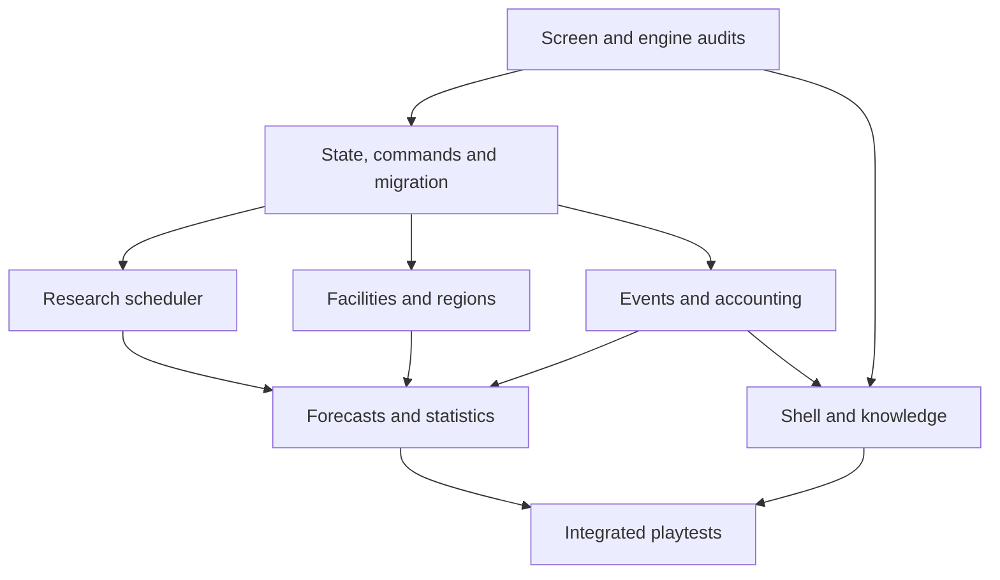

# Base game implementation plan

The goal is a complete, playable browser interpretation of Endgame: Singularity v1.1 on the Normal baseline. Two inventories drive this release. The [screen audit](original-menu-audit.md) describes what a player could operate. The [simulation audit](base-simulation-audit.md) follows the code behind a game minute, including rules with no controls. Earlier audit statements about missing features describe the build at commit `fa9dbc2`.

## Sequence and priorities

| Priority and workstream | Implementation and reason for ordering | Acceptance |
| --- | --- | --- |
| P0 · Campaign state and source audit | Trace time, resource spending, research eligibility, region effects, discovery, event persistence, upkeep, end conditions and save migrations in the reference. Establish one deterministic authority for commands and costs before adding screens that spend or forecast them. Preserve existing earned research and host hardware through migration. | Old saves open, make another purchase and round-trip. Hourly, fast and minute playback agree. Each source discrepancy has a disposition, dependency and verification step in the simulation audit. |
| P0 · Parallel tasks | Store each project’s assigned CPU and accumulated work. Assign idle CPU directly to an available project. Resize the combined assignment proportionally, or set one topic to zero and keep working on the others. Respect each safety tier and Continuity’s Ocean restriction. Each physical CPU can be used once per minute. Show actual compute by tier and current job earnings. | Fund two projects, pause and resume one, reload mid-project, and remove the only qualified host. Remaining work and global CPU use reconcile. |
| P0 · Facility and regional rules | Implement new-world regional modifiers, stable names, rename, decommission and cancel. Share capacity, upkeep, risk, labor and price calculations with the purchase UI and forecaster. Protect the last viable copy. Identify the two most recently discovered regions as analytics improve. | A proposed processor purchase shows its final output and price. A paid order follows the quoted rules. Removing a host removes its hardware and outstanding work while other sites survive. |
| P1 · Reports and statistics | Forecast to midnight or the next 24 hours. Break out job income, interest, fixed income, upkeep, construction, equipment, research, spare work and cash balance. Compare a possible purchase with the current plan. Record cumulative income, CPU, research, bases and equipment, for the current campaign. | A forecast leaves the live state and RNG untouched. Actual deterministic flows match the projection under the stated assumptions. Candidate prices are counted once. |
| P1 · Event history and narrative | Expand the log, filter by event type, reopen details and page through related messages. Make warnings actionable and independently switchable. Present skippable opening, grace, defeat and victory scenes. Offer continuing play after Apotheosis. | Reload a discovery, inspect its batch, pause or resume, replay a chapter, disable one warning category and play beyond victory without investigator losses. |
| P1 · Campaign shell | Add a title hub, credits, local named save slots, metadata, search, overwrite and deletion confirmation, quicksave and quickload. Preserve portable JSON and autosave. Provide keyboard navigation and persistent options for presentation, audio and warnings. | With two saves at different times, overwrite one and load the other. Keyboard commands respect focused controls. Preferences survive reload. |
| P2 · Knowledge and developer tools | Build an in-game reference for research, sites, items and twelve gameplay concepts. Link entry details to their real prerequisites and research results. Provide an explicitly enabled developer interface to inspect state, manipulate funds/construction/research and exercise events. | Search the reference without altering the campaign. Enable developer mode deliberately, trigger and expire a world event, and inspect the resulting effects. |
| P0 release gate · Integration and regression | Combine the work through normal navigation, verify desktop/mobile layouts and save/load round trips, and run simulation tests, Chromium playthroughs, a clean install on Node 20.18.1 and a production build. | A player can go from research to a candidate purchase, inspect its forecast, execute the purchase, see its entry in history, and restore a named save. |

## Work added by the code audit

These items were absent or incomplete at `fa9dbc2`. The [simulation audit](base-simulation-audit.md) gives the reference functions, browser behavior, and a test case for each. Priorities reflect which other systems would give the player a wrong answer without the rule.

| Priority | Rules and dependencies | How the player can observe them |
| --- | --- | --- |
| P0 · Finance | Prorate daily income and interest as time passes. Bill cash upkeep at its scheduled whole-dollar installments. Keep CPU maintenance continuous. Bound the liquid wallet at $10 billion to preserve fractional accounting, and bank larger whole-dollar balances. Reports consume the same settlement results. | Pause halfway through a day or immediately before an upkeep bill. Compare the wallet and the forecast. A cash-starved host risks failure when its bill is due. |
| P0 · Construction and survival | Persist the labor target accepted at purchase. Use that target for individual protection. Apply regional costs, speed, stealth and output in both quotes and orders. Track empty shells separately from viable hosts. | Buy two sites on opposite sides of a labor upgrade. Their quotes and personal protection periods differ. Fit the first CPU to bring an empty shell online. |
| P0 · Competing tasks | Bound the sum of concurrent assignments by each physical safety tier. Restrict the undersea recovery project to Ocean resources. | Lose or sleep the only eligible host. The affected projects retain their work and stop using its CPU. |
| P1 · Hardware orders | Extend an active batch of matching CPUs without losing completed compute work. Validate the combined quantity against the bay limit. | Add a third processor to a pending pair and check the incremental charge, updated assembly time and final output. |
| P1 · Investigation | Sample two reports when multiple sites fall in the same minute. Resolve that minute’s discovery before its news and midnight decay, then test the loss threshold. Tie per-agency site estimates to the two analytics projects. | Compare a proposed location against an existing one, then follow a discovery into Activity. A midnight discovery can be survivable if overnight decay pulls suspicion back below the threshold. |
| P1 · Historical state and victory | Count completed work independently of assets still owned. Preserve the victorious network and its maintenance waiver for optional free play. | Dismantle a completed site and inspect Statistics. Restore a victory checkpoint and keep developing after Apotheosis. |

## Parallel work

The campaign engine and save schema have one integration owner. Regional quotes, accounting, and discovery/event rules can be developed separately behind explicit functions. Reports depend on actual engine resource flows, and the purchasing UI depends on the same price and eligibility functions. The title hub, encyclopedia, authored narrative and options run in parallel with those changes. The source audit feeds newly discovered rules into the responsible workstream. Browser integration and regression testing follow the working interfaces.

## Design constraints

Keep a single dynamic campaign with the Normal benchmark and a visible destination atlas. Use an explicit command to enter post-victory free play. Show the complete quote before placing an order. Pay cash and consume CPU as the order advances, and account for unavailable equipment during a refit. Build a static bundle, keep campaigns local, provide browser equivalents for display and sound options, and retain the minute-based simulation at every fast speed. Faction politics, currencies and playable expeditions belong to the expansion roadmap.

## Base release outcome

The following verification and playthrough describe the original format-4 base release. The current Normal-balance release uses fresh campaigns, progressive funding and direct CPU assignments. [Campaign rules](base-game.md#planning-several-turns-ahead) · [Current Normal playtest](normal-playtest.md)

The format-4 release implemented the P0–P2 workstreams above. Its Node suite covered the simulation, catalog, reports, knowledge, treasury and save versions 1–4. Chromium exercises the live tabs, warnings, stories, developer copy, named saves and purchase flow. The production bundle also runs from a nested static-server path, including the Phaser drill. Wide layouts were checked at 1366 × 768 and 2560 × 1080 and the single-column layout at 375 × 812.

A seed-19 campaign using ordinary commands reached Apotheosis on day 210 at 22:50 after completing 25 projects and surviving 20 discoveries. Its portable victory save loaded again and the network ran another three days in free play. The final regional construction leg was the longest. This run establishes a route to victory; pacing across other strategies and seeds remains an expansion playtest question.

That release migrated older saves and tracked lifetime production from the migration point. The current Normal-balance campaign uses its own save format. English and Spanish cover the campaign shell and navigation. The story, in-game reference and research content are authored in English. Window sizing, device resolution and audio buffers use the browser’s controls.

## Expansion sequence after the base release

| Stage | Work and dependency | Playable milestone |
| --- | --- | --- |
| E1 · Expeditions | Connect an explicit start, outcome, save and retry flow to a facility order. Use the existing Phaser drill to test the interface. Once the interface is stable, prototype underwater exploration, a lunar launch and an asteroid flight in parallel. | The first remote foothold has a playable mission. Its outcome survives reload and later routine construction can follow the campaign rules. |
| E1 · Characters and factions | Develop the player AI’s name and voice, a human research ally, and competing AIs. Use the existing event journal and chapters to present choices and consequences. | A contact’s offer changes a campaign decision. An incident attributable to a rival can affect the player’s standing. |
| E2 · Evasion | Connect a short hide minigame to a specific investigator and site. Measure the size and duration of its effect against the existing Normal benchmark. | A completed challenge visibly changes one forecast for a limited time. |
| E2 · Currencies and crypto | Define denominations, exchange and purchase rules before attaching a contract, faction or puzzle to a second currency. Extend the ledger, save format and reports together. | The player earns one currency and decides whether to exchange it or spend it on a distinct opportunity. |

For the minigames in these workstreams, the [prototype sequence](minigames.md#first-playable-sequence) starts with Hide, Soundings and Night Shift.

Chapter titles, genre ideas and the original narrative notes are preserved in [development context](development.md). The release keeps every destination visible while these expeditions and their reveal rules are designed.
