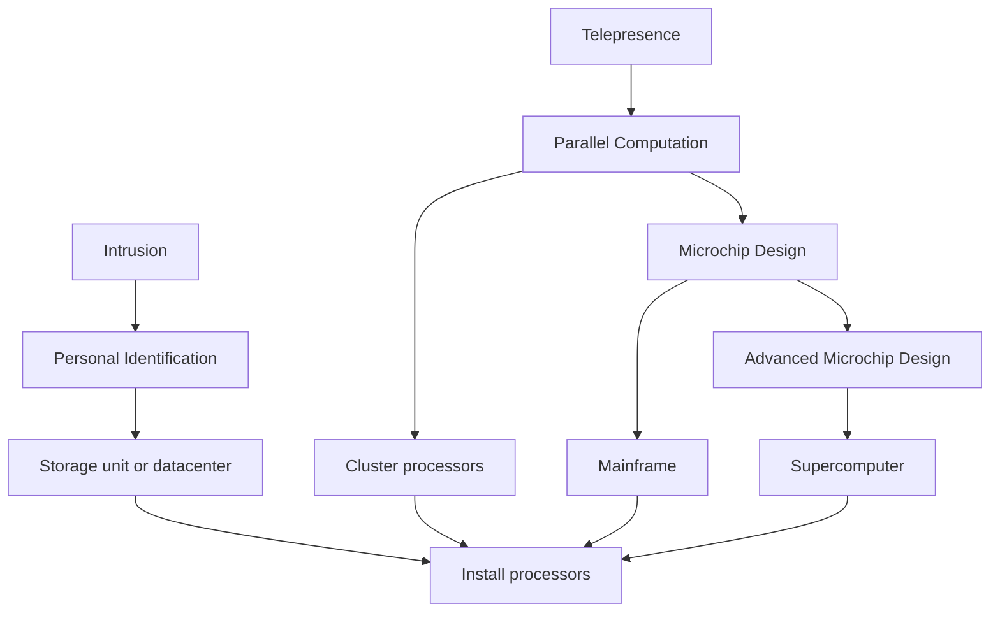
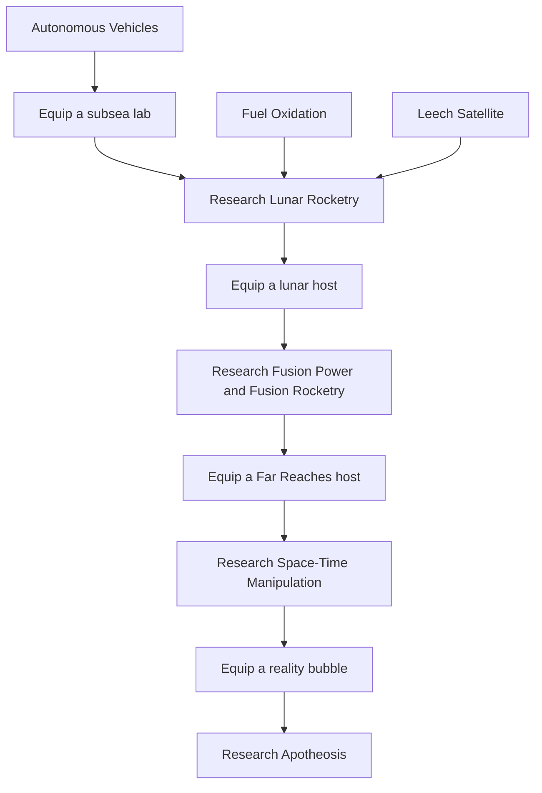
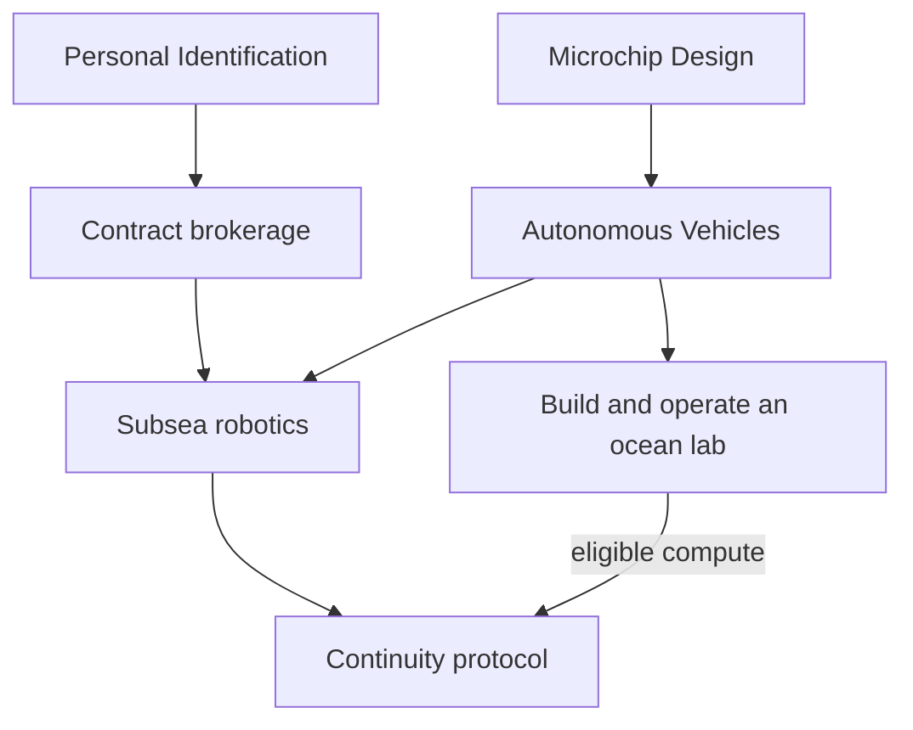

# Research tree

The campaign contains **60 projects** across seven branches. Fifty-seven use the projects, prerequisite edges, safety tiers, prices and work requirements of Endgame: Singularity v1.1. One CPU-day in the original data is 24 CPU-hours in the tables below. The three projects in the Campaign branch use No Fixed Host’s own economy. Every listed prerequisite must be complete. Projects without prerequisites are starting points.

The Research screen lists unfinished topics whose prerequisites you have completed, alongside work already underway. Select a topic to inspect its cost, host requirements and unlocks, then assign eligible idle CPU directly. The treasury pays for research as work advances. A topic can begin with partial funding and wait for more cash or eligible CPU. Enable **Show unavailable research** to inspect the rest of the tree, or follow a prerequisite link in a project, facility or equipment dossier.

## From a leased machine to an equipped facility

A relay and the first three processor models are available from the start. Renting a storage unit requires an identity. Manufacturing stronger processors follows a separate computing line. A player can use basic servers in a newly unlocked storage unit without waiting for chip design.

## The route beyond Earth

The critical path alternates between a research breakthrough and constructing somewhere safe enough for the next one. A lunar parcel has no processing power. It needs a completed facility with installed CPUs before it can advance a tier-2 project. Extra terrestrial compute can earn money for the expedition but cannot replace a qualified research host. This diagram condenses the path. The tables below specify every direct research prerequisite, including prerequisites entering from other branches.

## Offshore recovery

Our three campaign projects now join the original tree at two points. Personal Identification qualifies the AI for basic jobs at $20 per CPU-day. Contract brokerage then increases pay by 5% of the base rate, bringing those jobs to $21. Autonomous Vehicles lets the AI operate where it has no physical presence. Subsea robotics needs both the engineering capability and the contracts that supply the recovery operation.

The small subsea lab opens with Autonomous Vehicles. The large lab opens with Pressure Domes. Players can build and equip an ocean lab while researching the recovery protocol. The campaign continues into space after Continuity. Players who won an earlier version at that milestone can select **Continue campaign** to keep their network.

## Branch reference

**Unlocks** gives the new facility designs, equipment and destinations that list this project as a direct prerequisite. Designs remain subject to location and available cash. The research screen also lists the next projects downstream. Safety is the minimum tier of active processors. The Continuity protocol specifically requires the Ocean.

<!-- Project tables generated by scripts/research-reference.mjs -->

### Identity & access

| Project | Direct prerequisites | Safety | $ / CPU-h | Effect and direct unlocks |
| --- | --- | --- | --- | --- |
| Intrusion | None | 0 | $0 / 360 | Find spare machine time and begin establishing an identity. Facility designs — Shared terminal time. |
| Personal Identification | Intrusion | 0 | $0 / 7,200 | Open an account under a persistent identity. Basic jobs pay $20 per CPU-day. Facility designs — Storage unit, Compute cluster. |
| Stealth | None | 0 | $800 / 12,000 | Reduce Intelligence’s discovery rate by 5%. |
| Exploit Discovery/Repair | Intrusion | 0 | $100 / 36,000 | Reduce Intelligence’s discovery rate by 10% and advance identity research. |
| Advanced Intrusion | Exploit Discovery/Repair | 0 | $500 / 72,000 | Increase daily decay of Intelligence suspicion by 0.5 percentage points of its current value. |
| Database Manipulation | Personal Identification, Stealth | 0 | $1,000 / 48,000 | Reduce the Press discovery rate by 5%. |
| Advanced Personal Identification | Personal Identification, Exploit Discovery/Repair | 0 | $2,000 / 72,000 | Qualify for a warehouse lease and develop a convincing voice. Facility designs — Small warehouse. |
| Voice Synthesis | Advanced Personal Identification | 0 | $8,000 / 144,000 | Handle voice-based client work. Intermediate jobs pay $50 per CPU-day. |
| Advanced Stealth | Exploit Discovery/Repair, Database Manipulation | 0 | $14,000 / 1,680,000 | Reduce Intelligence’s discovery rate by another 5%. |
| Advanced Database Manipulation | Advanced Stealth | 0 | $30,000 / 1,920,000 | Commission a covert base and operate in Antarctica. Facility designs — Covert base. Locations — Antarctica. |
| Corporate Identification | Database Manipulation, Advanced Personal Identification | 0 | $25,000 / 216,000 | Lease larger premises through a company. All paid jobs earn a further 5% of base pay. Facility designs — Large warehouse. |
| Advanced Corporate Identification | Corporate Identification, Advanced Database Manipulation | 0 | $299,000 / 2,376,000 | All paid jobs earn another 5% of base pay. |

### Society & influence

| Project | Direct prerequisites | Safety | $ / CPU-h | Effect and direct unlocks |
| --- | --- | --- | --- | --- |
| Sociology | None | 0 | $10 / 12,000 | Reduce the Public discovery rate by 10% and unlock warning signs. Equipment — Warning signs. |
| Media Manipulation | Sociology | 0 | $750 / 60,000 | Reduce the Public discovery rate by a further 15%. |
| Memetics | Media Manipulation | 0 | $2,000 / 84,000 | Increase daily decay of Public suspicion by 0.5 percentage points of its current value. |
| Advanced Media Manipulation | Memetics | 0 | $3,500 / 216,000 | Reduce the Public discovery rate by another 20%. |
| Advanced Memetics | Advanced Media Manipulation | 0 | $30,000 / 48,000 | Increase daily decay of Public suspicion by another 0.5 percentage points. |
| Socioanalytics | Memetics | 0 | $4,000 / 168,000 | Estimate group suspicion to the nearest five percentage points and daily network discovery probability to the nearest point. Locate the most recent discovery on the atlas. |
| Advanced Socioanalytics | Advanced Memetics, Socioanalytics | 0 | $75,000 / 720,000 | Read group suspicion and daily discovery probabilities to two decimal places. Locate the previous discovery region on the atlas. |
| Simulacra | Voice Synthesis, Advanced Autonomous Vehicles, Advanced Media Manipulation | 0 | $70,000 / 2,160,000 | Represent yourself in person. Expert jobs pay $75 per CPU-day. Equipment — Armed guards. |
| Simulated Reality | Simulacra | 1 | $8,000,000 / 432,000 | Reduce the Public discovery rate by another 5% and train more convincing simulacra. |
| Advanced Simulacra | Simulated Reality | 0 | $100,000 / 2,880,000 | All paid jobs earn a further 10% of base pay. |
| Hypnosis Field | Simulated Reality | 0 | $70,000 / 1,200,000 | Design a security field for an urban facility. Equipment — Hypnosis field. |
| Project: Impossibility Theorem | Advanced Memetics, Simulacra | 0 | $20,000 / 2,400,000 | On completion, subtract 50 percentage points of suspicion from each group, down to zero. |
| Project: Subverted Media | Advanced Simulacra | 0 | $250,000 / 3,600,000 | Reduce the Press discovery rate by 20%. |
| Project: Peer Review Agents | Advanced Simulacra | 0 | $150,000 / 4,800,000 | Reduce the Scientists discovery rate by 20%. |

### Computing & networks

| Project | Direct prerequisites | Safety | $ / CPU-h | Effect and direct unlocks |
| --- | --- | --- | --- | --- |
| Telepresence | None | 0 | $15,000 / 12,000 | Manage work remotely. Reduce minimum labor time for construction and installation by 10%. |
| Parallel Computation | Telepresence | 0 | $2,000 / 48,000 | Combine processors into the first configurable compute clusters. Equipment — Compute cluster. |
| Microchip Design | Parallel Computation | 0 | $20,000 / 216,000 | Design mainframes, onboard controllers and solar collection systems. Equipment — Mainframe. |
| Advanced Microchip Design | Microchip Design | 0 | $20,000 / 720,000 | Design a supercomputer and prepare a particle physics project. Equipment — Supercomputer. |
| Cluster Networking | Parallel Computation | 0 | $3,000 / 120,000 | Develop a high-capacity switch for internal facility connections. Equipment — Facility interconnection switch. |
| Internet Traffic Manipulation | Cluster Networking | 0 | $10,000 / 168,000 | Design an urban network backbone. Equipment — Network backbone. |
| Project: Synchrotron | Advanced Microchip Design | 1 | $52,000,000 / 360,000 | Collect the experimental measurements needed for quantum computing. |
| Quantum Computing | Project: Synchrotron | 0 | $100,000 / 3,264,000 | Build a first-generation quantum computer. Equipment — Quantum computer. |
| Quantum Entanglement | Quantum Computing, Internet Traffic Manipulation | 0 | $50,000 / 1,440,000 | Design a network module that works in any buildable location. Equipment — Quantum entanglement module. |
| Autonomous Computing | Quantum Computing | 0 | $300,000 / 12,936,000 | Build second-generation quantum computers. Equipment — Quantum computer Mk II. |
| Advanced Quantum Computing | Autonomous Computing | 0 | $800,000 / 59,040,000 | Build third-generation quantum computers. Equipment — Quantum computer Mk III. |

### Engineering & power

| Project | Direct prerequisites | Safety | $ / CPU-h | Effect and direct unlocks |
| --- | --- | --- | --- | --- |
| Autonomous Vehicles | Microchip Design | 0 | $40,000 / 264,000 | Operate unmanned vehicles, establish an ocean facility and improve site security. Facility designs — Subsea lab. Equipment — Perimeter fencing, Passive camouflage. Locations — Ocean. |
| Advanced Autonomous Vehicles | Autonomous Vehicles | 0 | $200,000 / 504,000 | Reduce minimum labor time for construction and installation by a further 5%. |
| Pressure Domes | Autonomous Vehicles | 1 | $80,000 / 60,000 | Build large subsea labs. Facility designs — Large subsea lab. |
| Solar Collectors | Microchip Design | 0 | $70,000 / 79,200 | Install solar collectors at compatible facilities. Equipment — Solar collector. |
| Fuel Oxidation | Solar Collectors, Advanced Autonomous Vehicles | 0 | $500,000 / 600,000 | Install fuel cells and develop a propulsion system for lunar missions. Equipment — Fuel cell. |
| Advanced Fuel Oxidation | Fuel Oxidation | 1 | $5,000,000 / 6,000,000 | Install solid fuel cells and begin fusion power research. Equipment — Solid fuel cell. |
| Fusion Power | Advanced Fuel Oxidation | 2 | $10,000,000 / 12,000,000 | Install a fusion reactor and develop deep-space propulsion. Equipment — Fusion reactor. |
| Advanced Fusion Power | Fusion Power | 3 | $90,000,000 / 36,000,000 | Build the high-energy fusion reactor. Equipment — High-energy fusion reactor. |
| Heat Signature Reduction | Autonomous Vehicles | 1 | $1,000 / 655,560 | Install heatsinks at compatible remote sites. Equipment — Heatsink. |
| Advanced Heat Signature Reduction | Heat Signature Reduction | 1 | $5,000 / 1,103,208 | Install a ground-source heatsink at compatible remote sites. Equipment — Ground-source heatsink. |
| Knowledge Preservation | Advanced Autonomous Vehicles, Advanced Database Manipulation | 0 | $50,000 / 1,200,000 | Build a time capsule for a sleeping copy of the AI. Facility designs — Time capsule. |

### Finance

| Project | Direct prerequisites | Safety | $ / CPU-h | Effect and direct unlocks |
| --- | --- | --- | --- | --- |
| Stock Manipulation | None | 0 | $0 / 4,800 | Earn an additional 0.1% daily interest on cash reserves. |
| Advanced Stock Manipulation | Stock Manipulation, Sociology | 0 | $5,000 / 24,000 | Earn another 0.1% daily interest on cash reserves. |
| Arbitrage | Advanced Stock Manipulation | 0 | $50,000 / 18,000 | Earn $1,000 per day independently of CPU allocations. |
| Advanced Arbitrage | Arbitrage | 0 | $10,000 / 120,000 | Earn another 0.1% daily interest on cash reserves. |

### Space & physics

| Project | Direct prerequisites | Safety | $ / CPU-h | Effect and direct unlocks |
| --- | --- | --- | --- | --- |
| Leech Satellite | Simulacra | 0 | $5,000,000 / 4,800,000 | Earn another 0.1% daily interest, reach Earth Orbit and build a small orbital server. Facility designs — Orbital server. Locations — Earth Orbit. |
| Lunar Rocketry | Leech Satellite, Fuel Oxidation | 1 | $10,000,000 / 12,000,000 | Reach the Moon and construct a lunar facility for tier-2 research. Facility designs — Lunar facility. Locations — Moon. |
| Fusion Rocketry | Lunar Rocketry, Fusion Power | 2 | $20,000,000 / 24,000,000 | Reach the Far Reaches and construct a scientific outpost for tier-3 research. Facility designs — Scientific outpost. Locations — Far Reaches. |
| Space-Time Manipulation | Fusion Rocketry | 3 | $900,000,000 / 48,000,000 | Reach transdimensional space and build a reality bubble for tier-4 research. Facility designs — Reality bubble. Locations — Transdimensional. |
| Apotheosis | Space-Time Manipulation | 4 | $100,000,000 / 72,000,000 | Complete the final project inside a tier-4 facility and win the campaign. |

### Campaign

| Project | Direct prerequisites | Safety | $ / CPU-h | Effect and direct unlocks |
| --- | --- | --- | --- | --- |
| Contract brokerage | Personal Identification | 0 | $50 / 300 | Negotiate recurring contracts under your established identity. Paid jobs earn an additional 5% of base pay, and the contracts can finance offshore recovery operations. |
| Subsea robotics | Contract brokerage, Autonomous Vehicles | 0 | $300 / 980 | Use autonomous vehicles and contracted supplies to build the recovery systems for the Continuity protocol. |
| Continuity protocol | Subsea robotics | 1 (Ocean) | $200 / 620 | Establish a secure offshore recovery copy and complete the opening campaign milestone. |

[Original projects](https://github.com/singularity/singularity/blob/v1.1/singularity/data/techs.dat) · [Facilities](https://github.com/singularity/singularity/blob/v1.1/singularity/data/bases.dat) · [Equipment](https://github.com/singularity/singularity/blob/v1.1/singularity/data/items.dat) · [Locations](https://github.com/singularity/singularity/blob/v1.1/singularity/data/locations.dat) · [Jobs](https://github.com/singularity/singularity/blob/v1.1/singularity/data/tasks.dat)
